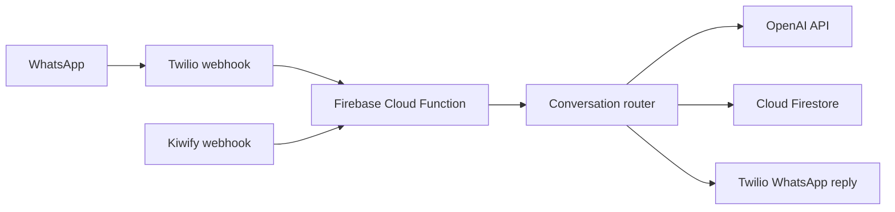

# Team-Bot

Team-Bot is a WhatsApp-based virtual fitness assistant. Its backend uses Firebase Cloud Functions to process messages, maintain each user's conversation flow, and connect OpenAI models to personalized workout and chat features.

## What it does

- Generates personalized gym and home workout plans from a user's profile and training goals.
- Provides a virtual fitness specialist that uses profile information, the user's current plan, and recent conversation history to answer questions.
- Transcribes incoming WhatsApp voice messages before processing them.
- Stores user, session, conversation, workout, and subscription data in Cloud Firestore.
- Sends WhatsApp messages through Twilio.
- Schedules daily motivational messages.
- Receives subscription events through a Kiwify webhook and updates subscription status in Firestore.

## How it works



The message handler routes each interaction to a conversation flow. When an AI feature is needed, the backend builds a request using the relevant profile, workout plan, and conversation context. Firestore stores the state needed to continue a conversation across messages.

## AI integrations

- **OpenAI Responses API:** virtual specialist conversations and structured workout-plan generation. The current implementation uses `gpt-5-nano` for these requests.
- **OpenAI audio transcription:** converts incoming OGG audio to text with `gpt-4o-mini-transcribe`.
- **Context:** recent chat history and user information are included when generating relevant responses.

## Technology

- TypeScript and Node.js 22
- Firebase Cloud Functions and Firebase Admin SDK
- Cloud Firestore
- OpenAI API
- Twilio WhatsApp messaging
- Kiwify subscription webhook

## Repository structure

```text
.
├── functions/
│   └── src/
│       ├── bot/       # Conversation routing and flows
│       ├── config/    # Environment variables
│       ├── handlers/  # HTTP and scheduled function handlers
│       ├── models/    # TypeScript data models
│       ├── services/  # OpenAI, Firestore, Twilio, and workout services
│       └── utils/     # Shared helpers
├── firebase.json
├── firestore.rules
└── firestore.indexes.json
```

## Run locally

### Prerequisites

- Node.js 22
- Firebase CLI
- A Firebase project with Cloud Functions and Cloud Firestore enabled

### Install dependencies

```bash
git clone https://github.com/diego-lanca/team-bot.git
cd team-bot
npm ci
npm ci --prefix functions
firebase login
firebase use --add
```

Configure the environment variables listed below for the Firebase Functions emulator before running features that call external services.

Start the local emulators from the repository root:

```bash
npm run emulators
```

Build or lint the Functions code:

```bash
npm --prefix functions run build
npm --prefix functions run lint
```

## Configuration

The backend reads the following variables from its environment:

| Variable | Purpose |
| --- | --- |
| `OPENAI_KEY` | OpenAI API key |
| `TWILIO_SID` | Twilio Account SID |
| `TWILIO_AUTH` | Twilio Auth Token |
| `TWILIO_FROM` | WhatsApp sender configured in Twilio |
| `TWILIO_MESSAGE_SID` | Twilio Messaging Service SID |
| `GENERATE_TRAIN_TEXT` | Instructions used to generate gym workout plans |
| `GENERATE_HOME_TRAIN_TEXT` | Instructions used to generate home workout plans |
| `TEAMBOT_LOGO_URL` | Logo URL used in bot messages |
| `KIWIFY_SECRET` | Secret used to validate Kiwify webhook signatures |

Keep API keys and tokens in your environment configuration. Do not commit real credentials or user data to the repository.

## Deploy

Select the Firebase project and deploy the Functions from the repository root:

```bash
firebase use <your-firebase-project-id>
firebase deploy --only functions
```

Configure the Twilio and Kiwify webhooks to point to the deployed function URLs in their respective dashboards.

## Privacy and limitations

The assistant may process profile details such as body measurements, goals, injuries, medical conditions, and medications. Relevant information can be sent to OpenAI when generating a workout plan or contextual response. Use synthetic data when testing or sharing examples, and review the privacy requirements of any deployment.

AI-generated training and wellness content is informational and does not replace advice from a qualified health professional.
